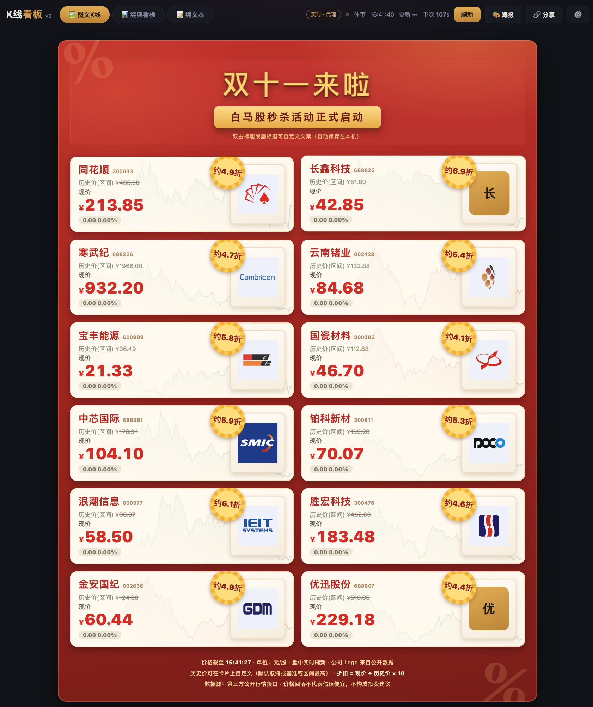

# 📈 K线看板 (kline-board)

> 一张会实时跳动的「双十一白马股海报」+ 一个极简纯文本行情终端。
> 纯前端、零依赖、单文件可部署 —— 把任意行情接口变成可分享的股票看板。

  

## 🖼️ 项目预览



## 💡 灵感来源

灵感来自下面这张「双十一白马股秒杀」营销海报（`douying.jpg`）——既然券商都把股票当商品打折卖，那就做一个能实时跳动、可自定义、可分享的同款看板：


## ✨ 特性

- **🖼️ 图文K线**：还原「双十一白马股秒杀」营销海报 —— 红金主题、划线历史价、大字现价、黄色爆炸折扣徽章、**公司真实 Logo**，价格盘中实时跳动
- **📊 经典看板**：暗色卡片首页（现价/四维报价/迷你走势/区间最高/海报基准对照）
- **📝 纯文本**：极简行情终端表格，排序 / 过滤 / 全市场搜索（代理模式下可搜任意 A 股）
- **📈 同花顺风格 K 线**：手绘 canvas 零依赖 —— MA5/10/20/30、成交量面板、最新价虚线+标签、十字光标联动报价信息栏、滚轮缩放（30–240 根）；分时含均价线/左侧百分比轴/时段刻度
- **🏷️ 公司 Logo**：接入百度股市通公开 CDN（`stock_ab_{code}.svg`），全市场规律地址、HTTPS、加载失败自动回退
- **🔗 分享即状态**：Tab、选中股票全部记录在 URL（`#/board?s=300308&m=33`），复制链接发给朋友，打开就是同一个视图
- **🎨 海报分享**：一键把当前看板选股生成**竖排 / 横屏**分享海报（红金主题、Logo、实时价格、折扣徽章），右下角自动嵌入当前页面**二维码**，支持下载 PNG / 复制图片
- **✅ 多选驱动看板**：纯文本 tab 勾选任意股票（最多 12 只），前两个 Tab 的海报/卡片看板即时跟随，选择持久保存本机
- **✏️ 可自定义**：海报标题/副标题双击编辑，每只股票的历史价、名称可改（仅存本机 localStorage）
- **🔌 三种数据模式**，开箱即用：
  | 模式 | 触发条件 | 实时性 | 全市场搜索 |
  |------|---------|--------|-----------|
  | 代理 | `node server.js` | ✅ 15s | ✅ |
  | 直连 | 页面 ⚙️ 里填 token（存 localStorage） | ✅ 15s | ⚠️ 仅 http 页面 |
  | 演示 | 以上都没有 | 内置快照 | ❌ |
- **🪶 零依赖**：无 npm install、无构建、无框架，`web/` 目录扔到任何静态托管即可

## 🚀 快速开始

```bash
git clone https://github.com/<you>/kline-board.git
cd kline-board
node server.js          # 或: PORT=9000 node server.js
# 打开 http://localhost:8787
```

没有 Node？`python3 -m http.server -d web 8000` 也能跑（仅演示模式）。

### 📦 打包成单个 HTML 文件

```bash
node scripts/build-single.js    # 生成 dist/kline-board.html（约 280 KB）
```

生成的 `dist/kline-board.html` 内嵌了全部样式、脚本和演示数据——**双击即可在本地浏览器打开预览**，无需任何服务，也可以直接发给朋友或放进任何静态目录。演示模式下展示内置快照数据；接入实时行情请用上面 ⚙️ token 或代理方式。

### 接入你自己的行情数据

数据层默认对接一个**第三方公开行情接口**（示例实现，需要登录 token，勘察与核验过程见 [ANALYSIS.md](ANALYSIS.md)）：

1. 浏览器登录数据源站点 → F12 → Network → 任意请求 → `Authorization: Bearer xxx`
2. 点页面右上角 **⚙️** 粘贴 token（存本机，不进代码库）；或启动时注入：
   ```bash
   YJNT_TOKEN=eyJhbGci... node server.js
   ```

token 只保存在你本机（localStorage / 环境变量），请勿提交到仓库。

### 接入其它数据源

数据层集中在 `web/app.js` 的 `api` 对象（`stockList` / `klineRaw` 两个方法），实现同名接口即可替换为 Tushare、长桥、富途等任意行情源，页面其余部分零改动。

## 🧭 URL 状态

| URL | 含义 |
|-----|------|
| `#/board` | 图文K线看板（默认） |
| `#/cards` | 经典暗色卡片看板 |
| `#/text` | 纯文本行情 |
| `#/board?s=300308&m=33` | 图文看板 + 选中中际旭创（自动弹 K 线） |

选中任意股票后点「🔗 分享」即可复制带状态链接。

## 📁 结构

```
├── server.js              # 可选：静态托管 + 接口反代（注入 token / 全市场搜索）
├── dist/
│   └── kline-board.html   # 打包产物：单文件纯 HTML（node scripts/build-single.js 生成）
├── scripts/
│   ├── build-single.js    # 单文件打包脚本
│   └── fetch-logos.js     # 公司 Logo 预下载到本地（node scripts/fetch-logos.js [代码...]）
├── web/
│   ├── index.html         # 图文K线看板（默认页）
│   ├── cards.html         # 经典暗色卡片看板
│   ├── text.html          # 纯文本行情（多选看板 / 全表头排序 / 全市场搜索）
│   ├── kline.html         # 独立K线页：kline.html?s=300308&m=33&t=DAILY|INTRADAY 可直链分享
│   ├── style.css          # 海报主题 + 暗色主题
│   ├── app.js             # 数据层 / 页面逻辑 / 分享海报
│   ├── js/charts.js       # 图表层：同花顺风格日K、分时、迷你走势（canvas 手绘）
│   └── assets/
│       ├── logos/         # 公司 Logo 本地缓存（运行时缺省自动回退远程 CDN）
│       ├── demo-data.json # 免 token 演示快照
│       └── favicon.svg
├── douying.jpg            # 灵感来源：双十一白马股营销海报
├── demo.png               # 项目运行截图
└── ANALYSIS.md            # 数据源勘察与海报数据核验报告
```

## ⚠️ 免责声明

本项目仅为行情可视化技术演示。展示的「历史价/折扣」为海报还原与自定义口径（部分与真实历史高点存在差异，见 [ANALYSIS.md](ANALYSIS.md) 的数据核验章节），**不构成任何投资建议**。请遵守数据源站点的服务条款，勿用于商业对外服务。

## License

[MIT](LICENSE)
